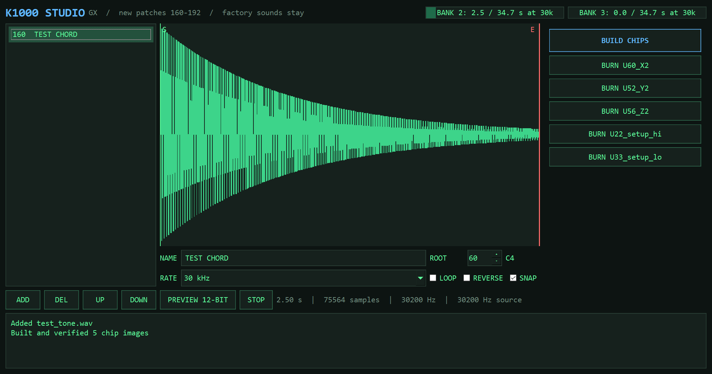

<p align="center"></p>

# Kurzweil 1000 Rosetta: the Kurzweil 1000 mod (custom samples + K1000 Studio)

**Kurzweil 1000 / K1000 mod** for the 1000 GX rack expander. Website: **[yuyoi.github.io/Kurzweil-1000-Rosetta](https://yuyoi.github.io/Kurzweil-1000-Rosetta/)**

Your own sounds in a **Kurzweil 1000 GX**, the 1988 guitar expander. The GX leaves two of its four wave ROM banks empty. K1000 Studio fills them from WAV files and adds each sound as a **new patch**. Every factory sound stays where it is.

> **Status: not played on real hardware yet.** The wave and SETUP formats are decoded and checked against factory data, and every chip image is verified in software. The first burn is next, and this page gets updated with what happens.

## K1000 Studio

<p align="center"></p>

- **33 new patches**, numbers 160 to 192, each with its own name on the LCD.
- **Drag in WAVs**, any bit depth, mono or stereo.
- **Trim and loop** by dragging markers on the waveform, with snap to zero crossings.
- **Root note** and **reverse** per sample.
- **Rate per sample:** 30 kHz, 15 kHz (2x time) or 7.5 kHz (4x time, crunchy).
- **PREVIEW 12-BIT** plays what the chip will hold.
- **69 s of sample time** at 30 kHz across the two free banks, up to 278 s at 7.5 kHz.
- **BUILD CHIPS** re-reads the finished images and checks them before you can burn.
- **BURN** each chip straight to an XGecu T48 through minipro.

### Run it

```bash
pip install PySide6 numpy sounddevice
pythonw k1000studio.pyw
```

Windows, Python 3.10+. The first build asks for your own U22 and U33 SETUP dumps. Burn buttons expect `minipro.exe` in `Documents\tools\minipro_win`.

## What you need

- A Kurzweil 1000 GX with SETUP V2.5 (U22 and U33). Other SETUP versions are refused.
- **W27C040** chips, three per bank, for the empty sockets:

| Bank | Address | X | Y | Z | Time at 30 kHz |
|---|---|---|---|---|---|
| 2 | `0xC00000` | U60 | U52 | U56 | 34.7 s |
| 3 | `0xE00000` | U61 | U53 | U57 | 34.7 s |

- Two **W27C512** chips for the new SETUP. Keep the original U22 and U33, they are your way back.
- Stock straps: JP7 open, JP5 open, JP11 closed, JP9 open.

The SETUP has to match the ROMs you fit, so swap the pair together.

## Dump your own SETUP

Kurzweil's data isn't included. Read your own chips:

```bash
minipro -p "AM27512@DIP28" -y -r gx_setup_hi_u22.bin
minipro -p "AM27512@DIP28" -y -r gx_setup_lo_u33.bin
```

## How it works

The sample format and object tables are written up in **[docs/FINDINGS.md](docs/FINDINGS.md)**.

- 3 chips (X, Y, Z) hold pairs of 12-bit sign-magnitude samples, about 1 million per bank.
- A program points to a keymap, a keymap to a soundfile, a soundfile to sample start, loop and end addresses.
- The OS indexes SETUP objects at boot, so new ones can be appended without moving a factory byte.
- Base sample rate is about 30.2 kHz, worked out from the factory sine waves.

## Not done yet

- First burn and listening test.
- PX Plus, SX and HX: their SETUPs aren't supported yet.
- Reaching patches above 159 from the front panel is unconfirmed. MIDI program changes 95 to 127 are mapped to them in the Presets table.

## Credits and legal

Built by JSW and Claude. Community hardware notes from [k1000.net](http://k1000.net), which made this much easier.

Tools are MIT licensed. No Kurzweil ROM data is included, and ROMs you build are for your own unit. Kurzweil is a trademark of its owner, and this project isn't affiliated with it.

God bless.
